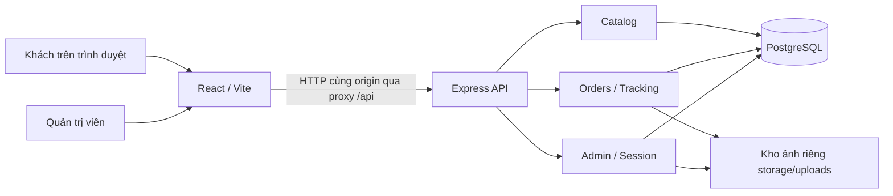

# Kiến trúc MVP và các quyết định

## 1. Mục tiêu và ranh giới

Một người cần demo sớm nên dùng **một backend chia module**. Frontend React và backend Express nằm trong một npm workspace. Database PostgreSQL lưu dữ liệu có quan hệ; tệp ảnh ở kho riêng trên máy. Không có microservices, broker, queue hoặc cloud trong P0.



Task A đã triển khai API catalog/orders/tracking/admin với kiểm thử PGlite. UI admin và việc nối frontend vào API mới còn ở B–D. Frontend trước C vẫn gọi route demo legacy; không tự chuyển đơn legacy thành orders.

## 2. Stack và lựa chọn vận hành

| Quyết định | Lý do / giới hạn |
|---|---|
| React + TypeScript + Vite | Form, preview và nhiều luồng màn hình chung một bộ công cụ; user đã chọn stack |
| Express 5 + TypeScript | HTTP API gọn, dễ chia router/service/repository |
| SQL PostgreSQL, thư viện pg | Schema rõ; không cần học/thêm ORM trước demo |
| Docker Compose PostgreSQL 18 | User có thể chạy Docker; Compose chỉ dựng DB, ứng dụng Node chạy trên máy |
| PGlite dự phòng | PostgreSQL nhúng lưu đĩa, không yêu cầu Docker; chỉ một process cho một thư mục DB |
| File local riêng tư | Đủ demo một máy; không để dưới public hoặc dùng Vite assets cho ảnh khách |
| Một admin cấu hình bằng env | Chưa có quản lý nhân viên; mật khẩu scrypt, phiên ngẫu nhiên lưu hash trong DB |

Docker và PGlite dùng chung SQL/adapter interface nhưng **không cùng dữ liệu**. PGlite chỉ là phương án chạy local, không mặc định tương đương PostgreSQL server về tải, đồng thời, extensions hoặc vận hành production. Adapter `postgres` cần kiểm tra thực khi Docker sẵn sàng.

Nguồn kỹ thuật đã đối chiếu: [Vite](https://vite.dev/guide/), [Express](https://expressjs.com/en/starter/installing/), [PGlite](https://pglite.dev/docs/), [PostgreSQL Docker image](https://hub.docker.com/_/postgres). Phiên bản dependency thực nằm trong package-lock.json; dùng npm ci để tái lập.

## 3. Cấu trúc và trách nhiệm

```text
apps/
  web/src/features/     editor, cart, checkout, tracking; admin còn task D
  api/src/
    app.ts             HTTP app, middleware và routes
    server.ts          bootstrap/listen
    db.ts              adapter PGlite / pg + transaction
    modules/           catalog, orders, tracking, admin — task A
database/              SQL migrations + fake demo seed
contracts/openapi.json API contract, chưa phải server sinh tự động
scripts/               setup, migration, kiểm tra DB/contract
docs/                  requirement, kiến trúc, kế hoạch, nghiệm thu
tasks/                 bốn phiếu triển khai tuần tự
tests/                 smoke API với database thử riêng
docs/qa/               báo cáo và bằng chứng kiểm tra
storage/               dữ liệu local, ignored, không đưa vào ZIP
```

Router/controller parse HTTP, nhận session và trả response. Service kiểm tra quyền, giá, trạng thái và nghiệp vụ. Repository chỉ thực thi SQL có tham số. Validation và upload middleware áp giới hạn trước service. Không cần tạo lớp trừu tượng chỉ để lặp lại một hàm SQL.

Frontend giữ draft đang sửa trong bộ nhớ. Giỏ lưu metadata/thumbnail tại `harmea.cart.v2`; B lưu Blob ảnh gốc/preview PNG riêng trong IndexedDB `harmea.editor.v1`, tham chiếu bằng assetKey mỗi snapshot. Không đưa Blob vào JSON/localStorage. Crop chuẩn hóa trong ảnh gốc theo chiều hiển thị; B có căn giữa/phóng/vị trí và renderer SVG chung cho preview/PNG. C nối multipart mới, D đối chiếu preview với dữ liệu trước sản xuất. Chữ ký dùng text; PNG chỉ là proof, không cam kết DPI/màu/bleed in thực tế.

Node 24 chạy trực tiếp TypeScript backend/scripts bằng type stripping; tsc vẫn kiểm tra riêng và build JS. Dùng `import type` cho type-only imports và extension `.ts` cho import tương đối trong source; tsc rewrite thành `.js` khi build. Không dùng enum/parameter properties/decorator cần transform ở backend. Frontend TSX do Vite xử lý. Xem [Node TypeScript](https://nodejs.org/api/typescript.html).

## 4. Tạo đơn nhất quán

1. Browser dựng preview rồi gửi một multipart: `payload` JSON có items[] + đúng một cặp `photo_i`/`preview_i` cho từng dòng i từ 0.
2. Server giới hạn tổng multipart 16 MiB, JSON 65.536 ký tự, từng ảnh 5/2 MiB và hai upload mỗi tiến trình. Web FormData có buffer giới hạn, không phải streaming-to-disk. Decode đầy đủ ảnh tuần tự, tối đa 20MP/cạnh8192, không fetch URL nhạc.
3. Đọc sản phẩm hiện hành, kiểm tra templateVersion; lấy giá từ DB. Tạo UUID đơn, số đơn, token tracking random 32 byte; hash token SHA-256.
4. Ghi ảnh đã xác minh vào thư mục riêng bằng tên server tạo. Lưu key tương đối; không tin path từ client.
5. Trong transaction: insert order chứa snapshot + các order_items + event `pending`, rồi commit. Khi ghi DB thất bại, xóa đúng các file vừa tạo; không xóa file của đơn khác.
6. Trả mã đơn, tiền hàng và raw tracking token **một lần**. Client tạo `/track#token`, cho sao chép liên kết.

Filesystem và DB không có chung transaction: process chết giữa bước 4/5 có thể để lại file mồ côi. P0 cần cleanup trong nhánh lỗi; quét file không còn tham chiếu là việc bổ sung sau, không quảng cáo atomicity tuyệt đối của hai kho.

`requestKey` UUID sinh ở client giữ nguyên khi thử gửi lại cùng yêu cầu; UNIQUE chống tạo thêm dòng. Gửi trùng trả 409. Đây **không phải replay response idempotent**: nếu response lần đầu bị mất, token thô không khôi phục được trong P0; admin hỗ trợ đối chiếu, không tự tạo thêm đơn. Giao diện cần giữ thiết kế và hiển thị thông báo rõ, không lặp POST vô hạn.

Preview client gửi chỉ là proof trực quan; admin phải đối chiếu với ảnh/cấu hình trước in. Không xem preview là bằng chứng chống giả mạo hay file in chính xác màu/kích thước.

## 5. Auth, tracking và trạng thái

- Admin password trong `.env` là scrypt salt/hash; dùng timingSafeEqual khi so sánh. Setup sinh mật khẩu local trong `.local-admin.txt`; module login đã có ở A, UI quản trị còn ở D. Hash sai/chưa cấu hình trả 503, không có mật khẩu mặc định.
- Login tạo session random, lưu SHA-256; expiry 8 giờ. Cookie `harmea_admin`: HttpOnly, SameSite=Lax; Secure khi HTTPS. Logout xóa DB session và cookie. Không session trong localStorage.
- Kiểm tra Origin với APP_ORIGIN cho request browser làm thay đổi dữ liệu; kết hợp session và rate limit cho admin. Không bật CORS `*` kèm credentials. Vite proxy giữ API cùng origin ở browser.
- Tracking token trong fragment không đi vào HTTP request trang; frontend POST body tới lookup. Không ghi token/body trong access log; Referrer-Policy no-referrer. API công khai chỉ chọn các trường cho phép, không spread bản ghi DB.
- Cập nhật trạng thái dùng expectedVersion + UPDATE có điều kiện; cùng transaction với event. Cập nhật thành công tăng version đúng một lần; xung đột 409, client tải lại.
- `producing -> shipping` là admin ghi nhận đã kiểm tra thành phẩm/NFC; website không kiểm chứng phần cứng.

## 6. Những màn hình cần triển khai

| Route dự kiến | Mục đích |
|---|---|
| `/` | Giới thiệu ngắn, sản phẩm và CTA tạo thẻ |
| `/customize` | Form + preview một mẫu |
| `/checkout` | Người nhận, số lượng, xác nhận thiết kế và gửi |
| `/order-success` | Kết quả vừa tạo và link theo dõi; không hứa phục hồi token khi reload |
| `/track#token` | Tiến độ công khai, nút làm mới |
| `/admin/login` | Đăng nhập quản trị |
| `/admin/orders`, `/admin/orders/:id` | Danh sách, chi tiết, ảnh, cập nhật trạng thái |

Đây là ranh giới chức năng, chưa phải thiết kế giao diện hoặc yêu cầu phải tạo tám page components độc lập. Có thể gộp customize/checkout thành hai bước trong một trang để kịp demo.
