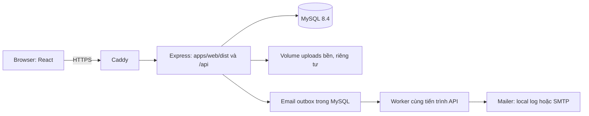

# Kiến trúc Harméa v2 — đích triển khai

F0 ngày 11/11/2026: đây là kiến trúc đích theo D1–D6, chưa phải stack đã triển khai. Code hiện tại vẫn là MVP PostgreSQL/PGlite + admin env; README giữ cách chạy tới F2/F3. F0 không cài dependency, đổi DB hoặc sửa code ứng dụng.

## 1. Luồng production dự kiến (G1–G3)



Một backend chia module, không microservices/broker. Gói bàn giao gồm image Docker, compose.prod.yaml và tài liệu; Caddy/app/MySQL là stack mẫu local. Caddy public 80/443, app/MySQL nội bộ; DB/uploads lưu volume. Người vận hành khác lo server/cloud/DNS/TLS/backup storage/giám sát; không thuộc roadmap. Gói Docker cần cho phép dùng proxy/DB bên ngoài. F8/G1b chưa chọn.

## 2. Stack và lộ trình

| Thành phần | Đích v2 | Trạng thái tại F0 |
|---|---|---|
| Web | React/TypeScript/Vite, router History API ở F7 | Giữ UI/tokens hiện tại, chỉnh thiết kế sau |
| API | Express/TypeScript, Node 24 | Giữ module hiện có |
| DB | MySQL 8.4, mysql2, SQL tham số qua db.ts | F2 mới chuyển, không chuyển dữ liệu demo cũ |
| Auth | users + sessions, role user/admin | F3 mới thay admin env |
| Mail | nodemailer, outbox + retry | F5 planned |
| Runtime | Docker Compose Caddy + app + MySQL | G1 planned, G3 hồ sơ bàn giao Docker |

Không thêm ORM/framework/UI/router. F2 lưu nguyên migration cũ vào database/postgres-legacy và tạo bộ MySQL mới có checksum. Không sửa migration đã áp dụng. Tests nghiệp vụ từ F2 chạy MySQL thật, DB thử tách biệt; kết quả PGlite không chứng minh MySQL/Docker.

## 3. Cấu trúc hiện tại, sẽ mở rộng theo task

```text
apps/
  web/src/features/     editor, cart, checkout, tracking, admin
  api/src/
    app.ts             HTTP app, middleware và routes
    server.ts          bootstrap/listen
    db.ts              adapter hiện tại; F2 chuyển mysql2 + transaction
    modules/           catalog, orders, tracking, admin — task A
database/              SQL migrations + fake demo seed
contracts/openapi.json API contract, chưa phải server sinh tự động
scripts/               setup, migration, kiểm tra DB/contract
docs/                  requirement, kiến trúc, kế hoạch, nghiệm thu
tasks/                 roadmap v2, F0–H; A–E là lịch sử
tests/                 smoke API với database thử riêng
docs/qa/               báo cáo và bằng chứng kiểm tra
storage/               dữ liệu local, ignored, không đưa vào ZIP
```

Router/controller parse HTTP, nhận session và trả response. Service kiểm tra quyền, giá, trạng thái và nghiệp vụ. Repository chỉ thực thi SQL có tham số. Validation và upload middleware áp giới hạn trước service. Không cần tạo lớp trừu tượng chỉ để lặp lại một hàm SQL.

Frontend giữ draft đang sửa trong bộ nhớ. Giỏ lưu metadata/thumbnail tại `harmea.cart.v2`; B lưu Blob ảnh gốc/preview PNG riêng trong IndexedDB `harmea.editor.v1`, tham chiếu bằng assetKey mỗi snapshot. Không đưa Blob vào JSON/localStorage. Crop chuẩn hóa trong ảnh gốc theo chiều hiển thị; B có căn giữa/phóng/vị trí và renderer SVG chung cho preview/PNG. C nối multipart mới, D đối chiếu preview với dữ liệu trước sản xuất. Chữ ký dùng text; PNG chỉ là proof, không cam kết DPI/màu/bleed in thực tế.

Node 24 chạy trực tiếp TypeScript backend/scripts bằng type stripping; tsc vẫn kiểm tra riêng và build JS. Dùng `import type` cho type-only imports và extension `.ts` cho import tương đối trong source; tsc rewrite thành `.js` khi build. Không dùng enum/parameter properties/decorator cần transform ở backend. Frontend TSX do Vite xử lý. Xem [Node TypeScript](https://nodejs.org/api/typescript.html).

## 4. Tạo đơn nhất quán

1. Browser dựng preview rồi gửi một multipart: `payload` JSON có items[] + đúng một cặp `photo_i`/`preview_i` cho từng dòng i từ 0.
2. Server giới hạn tổng multipart 16 MiB, JSON 65.536 ký tự, từng ảnh 5/2 MiB và hai upload mỗi tiến trình. Web FormData có buffer giới hạn, không phải streaming-to-disk. Decode đầy đủ ảnh tuần tự, tối đa 20MP/cạnh8192, không fetch URL nhạc.
3. Đọc sản phẩm hiện hành, kiểm tra templateVersion; lấy giá từ DB. Tạo UUID đơn, số đơn, token tracking random 32 byte; hash token SHA-256.
4. Ghi ảnh đã xác minh vào thư mục riêng bằng tên server tạo. Lưu key tương đối; không tin path từ client.
5. Trong transaction: insert order chứa snapshot + các order_items + event `pending`, rồi commit. Khi ghi DB thất bại, xóa đúng các file vừa tạo; không xóa file của đơn khác.
6. Trả mã đơn, tiền hàng và raw tracking token **một lần**. Client tạo `/track#token`, cho sao chép liên kết.

Filesystem và DB không có chung transaction: process chết giữa bước 4/5 có thể để lại file mồ côi. P0 cần cleanup trong nhánh lỗi; quét file không còn tham chiếu là việc bổ sung sau, không quảng cáo atomicity tuyệt đối của hai kho.

`requestKey` UUID sinh ở client giữ nguyên khi thử gửi lại cùng yêu cầu; UNIQUE chống tạo thêm dòng. Gửi trùng trả 409. Đây **không phải replay response idempotent**: nếu response lần đầu bị mất, token thô không khôi phục được trong P0; admin hỗ trợ đối chiếu, không tự tạo thêm đơn. Giao diện cần giữ thiết kế và hiển thị thông báo rõ, không lặp POST vô hạn.

Preview client gửi chỉ là proof trực quan; admin phải đối chiếu với ảnh/cấu hình trước in. Không xem preview là bằng chứng chống giả mạo hay file in chính xác màu/kích thước.


## 5. Auth/Session v2 (F3)

- users có email chuẩn hóa, password_hash scrypt, display_name, phone, default_address, role user/admin, status active/disabled. Có thể nhiều admin; đăng ký công khai chỉ tạo user.
- sessions lưu SHA-256 token ngẫu nhiên 32 byte, không raw token. Cookie harmea_session: HttpOnly, SameSite=Lax, Path=/, Secure khi HTTPS; user 30 ngày/admin 8 giờ. Không session trong localStorage/sessionStorage.
- loadSession kiểm tra hạn và user active; requireAuth trả 401, requireRole('admin') trả 403 cho user thường. Mọi admin API/tệp có guard; đơn user khác trả 404. Khách vẫn tạo đơn với user_id NULL.
- Login xoay token, logout thu hồi; đổi mật khẩu hủy phiên khác, reset hủy mọi phiên. Rate limit và Origin guard tiếp tục áp dụng. Không log mật khẩu/cookie/token/body/URL nhạc.
- admin_sessions và harmea_admin là cơ chế MVP hiện còn hoạt động, deprecated và chỉ gỡ ở F3.

## 6. Mailer (F5) và Storage

Outbox ghi cùng transaction với đơn/trạng thái; worker trong API gửi nền, retry tối đa 5 lần có backoff. Driver log ghi .eml riêng tại storage/outbox, không in nội dung. SMTP chỉ dùng khi cấu hình gửi thật. Reset dùng /reset-password#token, hash một lần, hạn 30 phút. Tracking token thô chỉ đưa vào email xác nhận ban đầu; outbox/tệp thư chứa bí mật phải giữ riêng tư, không log/commit.

Uploads ngoài public, key do server tạo, stream qua API sau xác thực. DB/filesystem không có transaction chung; dọn tệp khi request lỗi, còn giới hạn orphan khi crash. S3 chỉ khi người vận hành yêu cầu G1b: bucket private, IAM role, server stream sau xác thực.

## 7. Giao diện và nghiệm thu

F4: /login, /register, /account, /account/orders, /account/orders/:id. F5 thêm /forgot-password và /reset-password. F7 chuyển editor về /design, thêm landing/nội dung/404. Admin giữ /admin/login, /admin/orders. Đây là route đích, chưa cam kết route đã tồn tại.

Ưu tiên khung chức năng theo roadmap, tái sử dụng UI hiện tại. G1 hoàn thiện Docker sau F7, G2 CI/registry, G3 hồ sơ bàn giao và script backup/restore ở mức ứng dụng. H nghiệm thu đúng image Docker local để bàn giao; người vận hành tự thử trên server. Agent không viết runbook/script hạ tầng AWS. Chưa chạy không ghi PASS.
