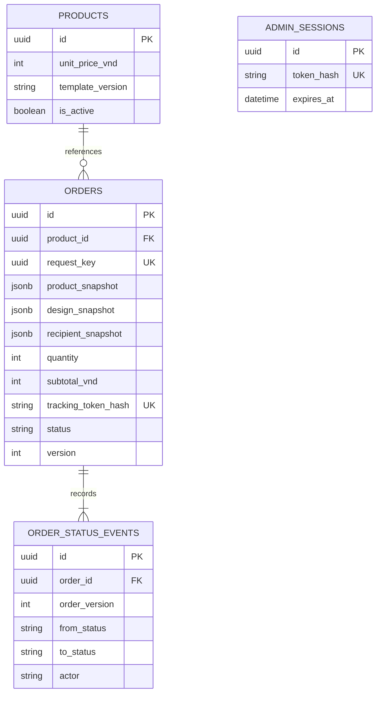

# Dữ liệu và hợp đồng API

Nguồn chuẩn: `contracts/openapi.json` cho HTTP và `database/*.sql` cho persistence. Phần này giải thích các quyết định để code frontend/backend khớp nhau. Các API nghiệp vụ đều **planned**; chỉ health được starter triển khai.

## 1. Mô hình dữ liệu



Một sản phẩm có 0..n đơn; mỗi đơn thuộc đúng một sản phẩm và có ít nhất event tạo `pending`. Ràng buộc ít nhất một event được service/transaction bảo đảm, FK một mình không bảo đảm. Admin duy nhất là cấu hình ngoài DB nên không có bảng users. Session dùng cho admin, không cho tracking khách.

Không có order_items: mỗi đơn đúng một thiết kế và số lượng các bản giống nhau. Khi cần nhiều thiết kế/giỏ hàng, thiết kế migration mới tách order_items; không giả định đã có trong MVP.

## 2. Snapshot và tiền

- `product_snapshot`: tên, templateVersion và thông số mẫu tại lúc đặt; `unit_price_vnd` chốt riêng trong order.
- `design_snapshot`: các trường cá nhân hóa + crop, không tham chiếu một draft có thể sửa sau đó.
- `recipient_snapshot`: người nhận, điện thoại, địa chỉ.
- `photo_key`, `preview_key`: key tương đối riêng tư; chỉ endpoint admin đã xác thực mới stream file.
- `subtotal_vnd = unit_price_vnd × quantity`. API dùng camelCase `subtotalVnd` và `shippingFeeVnd: null`; phí ship chưa được báo và xác nhận ngoài hệ thống. Không gọi đây là số tiền đã thanh toán.
- Giá seed 50.000 VND là giả. Mọi số tiền là integer VND, không float.

## 3. Các endpoint

| Method/path | Người dùng | Chức năng |
|---|---|---|
| GET `/api/health` | Public | Liveness đã có |
| GET `/api/products/current` | Public | Một sản phẩm/template đang bán |
| POST `/api/orders` | Guest | Tạo đơn multipart |
| POST `/api/tracking/lookup` | Có token bí mật | Tra cứu chỉ dữ liệu public |
| POST `/api/admin/session` | Login | Tạo phiên admin |
| DELETE `/api/admin/session` | Admin | Hủy phiên |
| GET `/api/admin/orders` | Admin | Danh sách có phân trang/lọc trạng thái |
| GET `/api/admin/orders/{id}` | Admin | Chi tiết + lịch sử |
| PATCH `/api/admin/orders/{id}/status` | Admin | Chuyển trạng thái kèm expectedVersion |
| GET `/api/admin/orders/{id}/assets/{kind}` | Admin | Stream ảnh `photo` hoặc `preview` |

Tham số, required fields, validation và error codes đọc trực tiếp trong OpenAPI; không tự đổi response ở frontend. `npm run contract:check` kiểm tra hợp đồng hợp lệ, không xác nhận server triển khai đúng hợp đồng.

## 4. Payload tạo đơn

Multipart có đúng ba phần: `payload` là JSON string, `photo` là JPEG/PNG, `preview` là PNG. Ví dụ nội dung payload (dữ liệu hư cấu):

```json
{
  "requestKey": "22222222-2222-4222-8222-222222222222",
  "productId": "11111111-1111-4111-8111-111111111111",
  "templateVersion": "harmea-card-v1",
  "quantity": 2,
  "designConfirmed": true,
  "design": {
    "fullName": "Demo Harméa",
    "dateOfBirth": "2003-01-01",
    "place": "Hà Nội",
    "commemorativeDate": "2026-10-28",
    "signatureText": "Demo",
    "musicUrl": "https://www.youtube.com/watch?v=demo",
    "crop": { "x": 0, "y": 0, "width": 1, "height": 1 }
  },
  "recipient": { "name": "Khách Demo", "phone": "0900000000", "address": "Địa chỉ giả cho demo" },
  "note": "Dữ liệu thử, không giao hàng thật"
}
```

URL trên là placeholder minh họa schema, không phải bài hát đã xác minh. Trước demo thay bằng URL phát được mà bạn chọn. ID requestKey phải sinh mới cho lần đặt mới; giữ nguyên khi retry cùng lần gửi. Không copy UUID ví dụ cho mọi đơn.

Photo tối đa 5 MiB; preview tối đa 2 MiB; decoder giới hạn 20MP/cạnh8192. Crop phải nằm trong [0,1], width/height >0, x+width<=1, y+height<=1. Ngày dùng YYYY-MM-DD và kiểm tra ngày có thật; DOB không trong tương lai. URL chỉ HTTPS/hostname nằm trong allowlist của schema, không credentials/custom port; không fetch server-side.

## 5. Trạng thái, lỗi và đồng thời

```text
pending -> confirmed -> producing -> shipping -> completed
    |           |
    +-----------+----> cancelled (bắt buộc lý do)
```

Không nhảy bước/quay lùi; completed/cancelled kết thúc. Admin PATCH gửi version đang thấy; UPDATE WHERE id=$id AND version=$expectedVersion; tăng version và insert event cùng transaction. Khi không cập nhật được, phân biệt không có đơn và xung đột phiên bản; không ghi event giả.

Error envelope thống nhất: `{ "error": { "code": "...", "message": "...", "fields": {} } }`; fields tùy chọn. HTTP 401 cho thiếu phiên admin; 404 cho tài nguyên/tracking không thấy; 409 cho gửi trùng, version hoặc trạng thái xung đột; 413 cho quá kích thước; giới hạn validation xem hợp đồng.

Tracking response phải được xây từ allowlist (mã đơn, status, timestamps, progress/trackingCode theo schema); không trả recipient/design/photo/musicUrl/internalNote/cancellationReason nguyên văn. Một người có token không có quyền quản trị. Token thô không lưu trong DB; chỉ trả lúc create thành công. Mất token cần hỗ trợ ngoài hệ thống trong P0.

## 6. Migration và kiểm thử

`001_initial.sql` tạo bốn bảng. `002_seed_demo.sql` thêm một sản phẩm demo. Script migration có checksum và bảng schema_migrations; chạy lần hai phải bỏ qua file đã áp dụng. Không sửa migration đã chạy, thêm file 003_... nếu cần thay đổi.

Khi triển khai task A, cần chứng minh rollback khi tạo order/event lỗi, UNIQUE requestKey, privacy tracking và cập nhật optimistic concurrency. Không coi kiểm tra schema/seed của starter là kiểm thử nghiệp vụ này.
